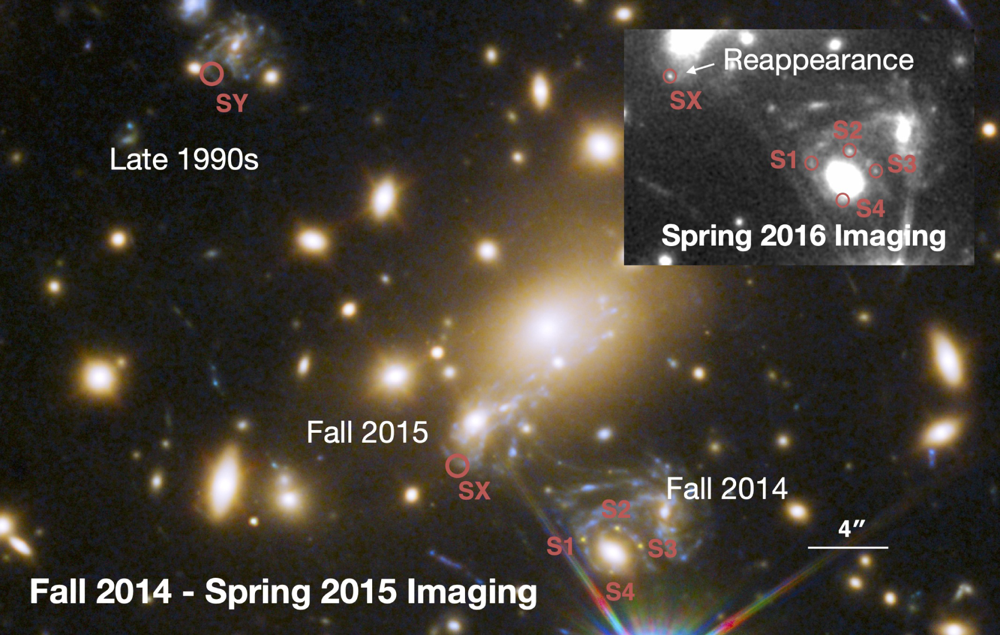
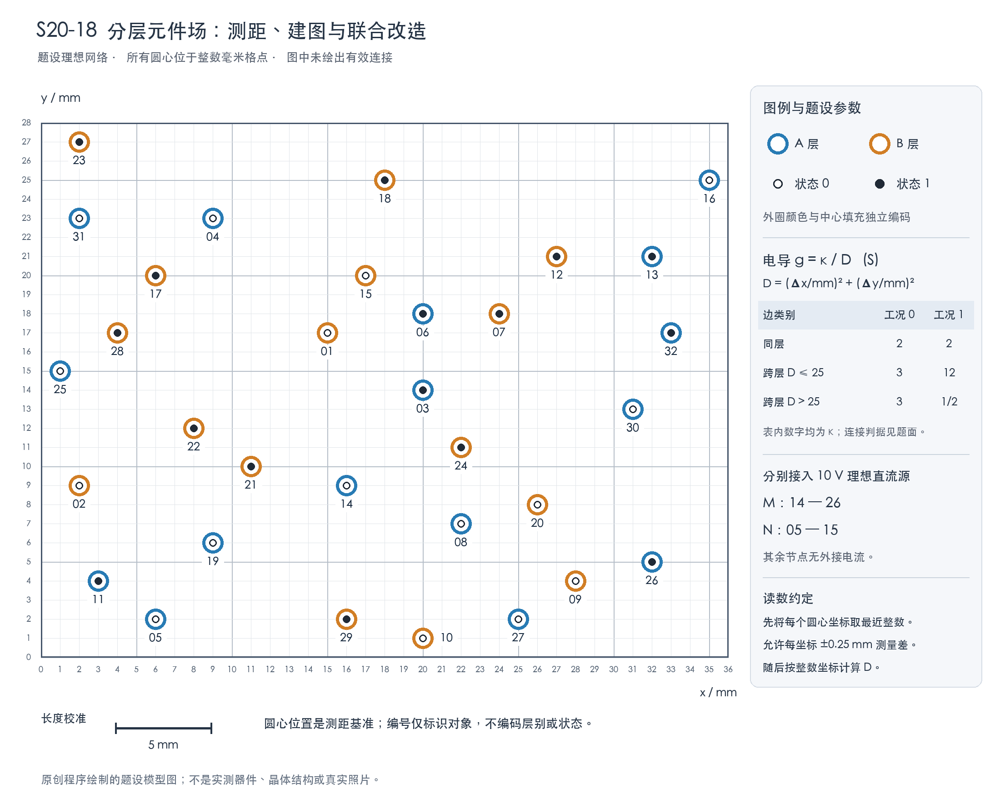
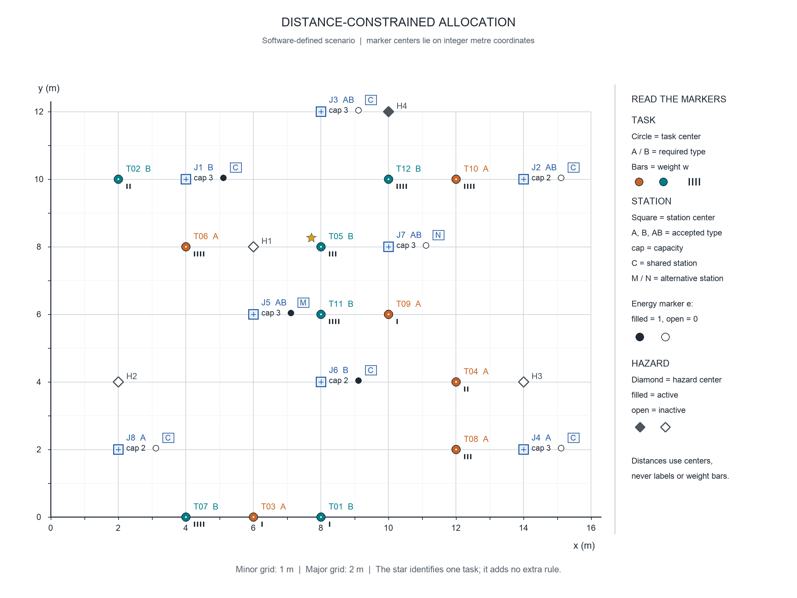

# 三道带图的已冻结例题

做真实原图题时先看 VC-04，做“读图—测距—多问联合计算”时看 S20-18 和 S20-19。三张图可在本包离线查看。作者材料中的答案、打点和错误示例只供出题和审题参考，复用方法时另选素材与参数。

## VC-04 授权图版 · 一幅观测图如何决定两套配对

**原图署名。** P. L. Kelly et al. (2023), *The Magnificent Five Images of Supernova Refsdal: Time Delay and Magnification Measurements*, *The Astrophysical Journal* 948, 93, Fig. 1. © 2023 The Author(s), published by the American Astronomical Society. CC BY 4.0。随包 JPG 保留原始图面，未改动。右上小图是观测合成曝光，展示超新星重现后该区域的成像结果。[论文与许可记录](https://www.repository.cam.ac.uk/items/9458edb5-1445-471e-850e-3b6f2aad614c) · [许可条款](https://creativecommons.org/licenses/by/4.0/) · [出版社原图](https://content.cld.iop.org/journals/0004-637X/948/2/93/revision1/apjac4ccbf1_hr.jpg) · [作者图注，第 3 页](https://arxiv.org/pdf/2305.06377#page=3)

只在右上小图寻找离 SX 最近的带 S 编号红圈，从它起绕星系中心顺时针编号。四个位置依次对应 S1、S2、S3、S4，其中最低的是 S4。M 连接位置 1–2 与 3–4，N 连接 2–3 与 4–1。图首先决定配对，再决定哪条边接受题设的 5 天加罚。每行只有两条边都过时间与亮度比门限时才能计入该行的权重。观测图、用于计算的七行数值、作者另加的工况各有明确出处。[计算参数来源，Rodney 等表 2](https://doi.org/10.3847/0004-637X/820/1/50)

| 授权图版 | M 得分 | N 得分 | 赢家 |
|---|---:|---:|---|
| 原工况 | 51 | 70 | N |
| 触及最低圈的边每条加 5 天 | 51 | 32 | M |

作者错读复算将最低圈误配为 S3，两次均由 N 胜。该例展示怎样保留必要规则，将“对象是谁”留给图。既有开放工具复测报告的 **2/2** 属于另一道同号的遮挡版，其原工况比分为 **70、51**。本例仅列授权图版作者答案 `S4|51,70,N|51,32,M`。

## S20-18/v3 · 距离、状态和层别共同建电路

两幅 S20 题图均为本项目用软件绘制的模型。这里的圆心位于整数毫米格点，外圈表示层别，圆心空实表示状态。公开规则只连接状态相异且满足本类别距离阈值的一对元件。平面中心距平方 D 不仅用于选边，也与层别一起决定跨层边所用的电导系数。图内表格给出参数和接线端点。作者保存 41 个打点，包括元件、标定、参数与端点。

六问依次求局部跨层邻居与指定 D、全图有效边数、两工况功率比、反转标志、预算内端点互斥的双边改造数，以及使两种接线中较低功率最大的改造和功率。正确图有 41 条有效边和 138 种可行改造。唯一最优边对为 14–21 与 20–26，较低功率为 1065.028 mW。

- **作者设计的测距误配。** 量 20–26 时若把 20 的圆心错绑到邻近 09，D 从 45 变成 17，这条边改用另一行系数。重新计算后反转从 1 变为 0，改造数从 138 变为 146。这是一次有意改变的局部测量记录。
- **四轮实际错读。** 四轮的坐标、层别和指定 D 均正确。最后有 1–3 个其他位置的空实状态仍错。同一求解程序在各轮最后采用的状态表上，分别复现四份末答。四轮各答对 2、2、3、2 个字段，总字段数为 12。

## S20-19/v3 · 一个工位的类型怎样改变全局排序

测量 T、J、H 编号标记的中心。在生效干扰点 2.5 m 内的工位停用。任务与工位须类型相容且相距不超过 6.5 m。同类型且相距不超过 3 m 的两项任务不能共用工位。再施加容量与两套备用工位方案，对每个完整分配累加加权距离成本。第二工况额外计入与能耗有关的代价。每个阈值采用题面写明的等号口径，在确认对象身份后，原图每轴 ±2 px 的误差最多使两中心距离改变 0.05657 m，最小阈值余量约为 0.17157 m。

| 连续的小问 | 标准结果 |
|---|---|
| ① 有效共享容量，星标任务到两备站的平方距离 | 12，8 m²，4 m² |
| ② 两种方案的兼容边数，无序互斥任务对数 | 29、27 条边，4 对 |
| ③ 容量和互斥同时满足时的完整分配数 | M 有 274 种，N 有 89 种 |
| ④ 工况 0 的最小代价及达到它的方案数 | M 为 484（1 种），N 为 540（2 种） |
| ⑤ 工况 1 的最小代价及达到它的方案数 | M 为 964（1 种），N 为 768（1 种） |
| ⑥ 赢家是否反转，工况 1 赢家的规范分配 | M→N，反转位为 1，按 T01 至 T12 的工位编码为 `618728644277` |

**一次实际错答。** 第一轮在裁图后修正了任务坐标和三处权重，最后只把工位 J2 的接收类型 AB 记为 A。T05、T12 原本均能连 J2，距离平方分别为 40、16。漏掉 B 后，这两条边同时消失，两方案的合法数变为 188、29。工况 0 的最小代价变为 548、540，工况 1 变为 1076、780，N 两次都赢。只替换 J2 这一项就能复现整份末答。

另三轮保留了正确的兼容关系、计数、赢家和规范方案，但少读了一个或多个任务的权重，四个最优成本都偏低。只评反转位会让这三份答案通过。完整题面、标点及两段作者解答可直接照实际字段查看。[S20-19 已填写的单题记录](S20-19-example.json)
